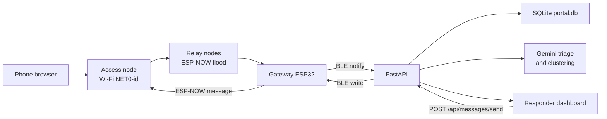
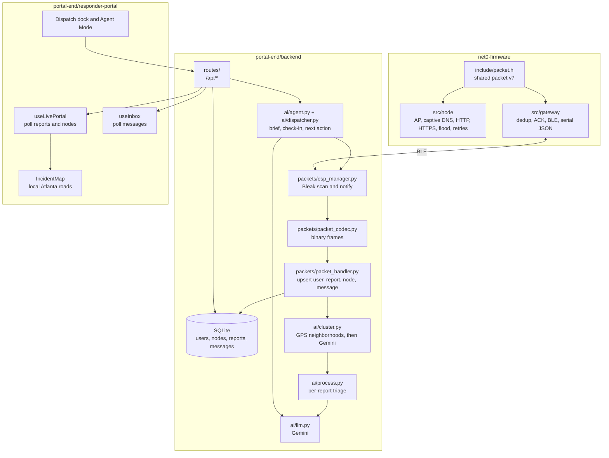

# net0

Off-grid emergency reporting for HackGT 13. A phone with no internet joins a nearby ESP32, sends a distress report, and the report hops across other ESP32s until a gateway board delivers it over Bluetooth to a laptop. The laptop stores the report, optionally structures it with Gemini, and shows it on a responder dashboard. Responders can message the phone back through the same mesh.

The mesh, the database, and the dashboard keep working when the cloud model is unreachable. AI fields stay empty until Gemini answers.

## How a report moves



1. The phone joins `NET0-<id>` (open Wi-Fi, gateway address `192.168.4.1`). The node serves a captive-portal form on port 80 and, when a certificate is flashed, the same form over HTTPS on port 443.
2. The form posts the report to the node. The node floods it over ESP-NOW. Every other node forwards a packet it has not already seen, once, to neighbors heard in the last 35 seconds.
3. The gateway does not relay mesh traffic. It deduplicates, encodes the packet, and notifies the laptop over BLE. It also prints one JSON line per packet on USB serial at 115200 baud.
4. FastAPI writes the user and report to SQLite, then sends an ACK back over BLE. The gateway floods that ACK. The origin node stops retrying, and the phone page flips from “SOS SENT” to “SOS DELIVERED”.
5. A background job asks Gemini for a priority, category, responder types, and summary, then groups nearby reports into one incident. The dashboard polls the API every 4 seconds.
6. A dispatcher message is written to the gateway over BLE, flooded as a mesh message, and shown in the phone’s chat. A reply from the phone travels the same path as a report and lands in the `messages` table as `direction = uplink`.

## Repository layout

| Path | What it is |
| --- | --- |
| `net0-firmware/` | Current ESP32 firmware. One PlatformIO project, separate builds for nodes and the gateway. |
| `portal-end/backend/` | FastAPI server, SQLite, BLE client, AI pipeline, Debug Lab. |
| `portal-end/responder-portal/` | Live React dashboard. |
| `portal-end/frontend/` | Earlier mock dashboard. It is not wired to the API. Use `responder-portal`. |
| `user-end/` | Leftover PlatformIO build output from before the firmware moved into `net0-firmware/`. There is no source to flash here. |
| `setup.md` | Short teammate notes. This README is the full setup. |

## What you need

- Python 3.11 or newer (this tree has been run on 3.13) and `pip`
- Node.js with npm, for the dashboard
- [PlatformIO](https://platformio.org/) (`pio` on the PATH, or the PlatformIO IDE extension in VS Code / Cursor)
- Six classic ESP32 DevKit boards (WROOM-32, `board = esp32dev`) if you are flashing hardware. The portal can run on seed data with no boards.
- A laptop Bluetooth adapter for the gateway link. macOS must allow the terminal or IDE to use Bluetooth.
- A [Google Gemini API key](https://aistudio.google.com/apikey) if you want triage, clustering summaries, and Agent Mode. Reports still save without it.

## Portal backend

From the repo root:

```bash
cd portal-end/backend
python3 -m venv .venv
source .venv/bin/activate
python3 -m pip install -r requirements.txt
cp .env.example .env
```

Edit `.env`:

| Variable | Purpose |
| --- | --- |
| `GEMINI_API_KEY` | Required for AI. Leave the placeholder and the portal still stores and displays raw reports. |
| `GEMINI_MODEL` | Defaults to `gemini-3.5-flash-lite`. |
| `DATABASE_URL` | Optional. Default is `sqlite:///./portal.db` in `portal-end/backend`. `psycopg2-binary` is installed if you point this at Postgres. |
| `DEBUG` | Optional. Debug routes are on unless you set `DEBUG=0`. |

Create the schema and load the shared seed file (`portal-end/backend/data/seed_data.json`):

```bash
bash scripts/setup.sh
```

That runs `alembic upgrade head`, then `python3 scripts/seed_db.py` in merge mode. If Alembic cannot run on a fresh database, the script falls through and `fastapi dev` creates tables on startup. Start the server from `portal-end/backend` so the SQLite file lands in that folder:

```bash
fastapi dev
```

| URL | What it is |
| --- | --- |
| http://127.0.0.1:8000/ | `{"status":"online"}` |
| http://127.0.0.1:8000/docs | Interactive API docs |
| http://127.0.0.1:8000/debug | Debug Lab: CRUD for users, nodes, reports, and messages, plus fake heartbeats and reports |
| http://127.0.0.1:8000/api/health | Health check the dashboard probes |

On startup the server creates any missing tables, starts a BLE scan for the gateway, and marks a node offline when no heartbeat has arrived for 35 seconds (the sweep runs every 5 seconds).

`portal.db` is gitignored. Share data through `data/seed_data.json`:

```bash
python3 scripts/export_db.py          # writes data/seed_data.json
python3 scripts/seed_db.py            # merge into the local database
python3 scripts/seed_db.py --replace  # wipe tables, then load the file
python3 scripts/gen_docs_pdf.py       # writes docs/portal_api_and_models.pdf
```

After a model change: edit `models/*.py`, then `alembic revision --autogenerate -m "describe"`, `alembic upgrade head`, export, and commit the new revision plus `data/seed_data.json`. Startup also adds a few newer `reports` columns if an old SQLite file is missing them.

The Debug Lab page can export, import, reset (`POST /api/debug/reset`), and insert random rows (`POST /api/debug/seed_random?count=5`). Turn those routes off with `DEBUG=0 fastapi dev`.

## Responder dashboard

```bash
cd portal-end/responder-portal
npm install
npm run dev
```

Vite serves the app (usually http://127.0.0.1:5173) and proxies `/api` to `http://127.0.0.1:8000`. Override the proxy with `VITE_API_PROXY`. The client also probes `127.0.0.1:8000` directly, because `localhost` on macOS often resolves to IPv6 while `fastapi dev` listens on IPv4 only. `VITE_API_URL` forces a base URL. `VITE_API_PORT` changes the probed port (default `8000`).

`npm run build` typechecks and writes `dist/`. `npm run preview` serves that build with the same proxy. `npm run lint` runs Oxlint.

The dashboard has two views:

- **Home.** Open reports, grouped by person, with responder-type filters. Selecting a report acknowledges it. The map is a local OpenStreetMap extract of a slice of Atlanta (`public/maps/atlanta.geojson`, ODbL). Leaflet draws reports that include a phone GPS fix. The laptop’s own GPS, if the browser allows it, is the start of a dispatch route. Street distance is computed on that local road graph, with no tile server and no geocoder.
- **Messages.** One thread per user. Outbound texts go to `POST /api/messages/send` and only leave the laptop when that user’s origin node is known and the gateway BLE link is up.

**Dispatch** queues selected reports, orders stops from the laptop’s GPS, and on send writes each person a “help is on the way” message, then marks those reports resolved. Resolved rows stay in SQLite and drop out of the open list.

**Agent Mode** locks the page and drives it from `POST /api/ai/dispatcher/next`. Gemini picks the next action (focus a report, queue stops, open a thread, send a check-in, or dispatch). The browser performs the click. The agent pauses when the API key is missing or Gemini rejects the call. The cursor and thought line show the step it is on.

## Firmware

All current firmware is `net0-firmware/`. Open that folder in PlatformIO. You can build every board; upload one board at a time. The platform is pioarduino (Arduino-ESP32 3.x) so ESP-NOW v2 is available. The stock `platform = espressif32` package is ESP-NOW v1 and is the wrong toolchain for this project.

Each board’s `NODE_ID` is set in `platformio.ini` (`0` is the gateway, `1`–`5` are the nodes).

```bash
cd net0-firmware
pio run                                      # build gateway and all five nodes
pio run -e node2 -t upload                   # flash one board
pio run -e node2 -t uploadfs                 # flash data/ onto a node (not the gateway)
pio device list                              # ports, when more than one board is plugged in
pio run -e node2 -t upload --upload-port /dev/cu.usbserial-XXXX
pio device monitor -b 115200
./scripts/make_cert.sh                       # once, then uploadfs on every node
```

If upload stalls on `Connecting...`, hold the board’s BOOT button and retry. Node filesystem uploads use LittleFS. The gateway uses the `huge_app` partition table because Wi-Fi and BLE do not fit the default app slot, and it uploads at 460800 baud.

`scripts/make_cert.sh` writes a self-signed ECDSA P-256 certificate to `data/cert.pem` and `data/key.pem` (gitignored) with SAN `IP:192.168.4.1` and `DNS:net0.local`. Phones warn that the certificate is not trusted; the user has to continue anyway. GPS is only available on the HTTPS page in Safari or Chrome. The captive-portal sign-in popup cannot prompt for location, so the page tells the user to open `https://192.168.4.1` in the real browser. Reports can still be sent from the popup without a fix.

### Phone page

Files in `net0-firmware/data/` (`index.html`, `style.css`, `app.js`) are what the node serves.

| Request | Behavior |
| --- | --- |
| `GET /` | SOS form |
| `GET /whoami?id=` | Resolves the phone’s user id and returns this node’s id |
| `POST /send` | New report |
| `GET /status?id=<hex msg_id>` | Whether the gateway ACK arrived |
| `POST /reply` | Chat line from the phone |
| `GET /messages?id=&after=` | Chat log, polled about every 3 seconds |

The form asks for a name, emergency type (medical, trapped, fire, other), people count, optional location text, optional GPS, and details. “Other” requires details. The node remembers a phone’s Wi-Fi MAC to user id in flash, and the page also stores the id in `localStorage` and a cookie. The same phone on the same node keeps the same id. A different node sees a different MAC and assigns a new id unless the browser still has the stored one. The on-node chat log is RAM only and disappears on reboot. The portal database is the record that survives.

### Gateway on the laptop

Flash the `gateway` env, plug the board into the laptop over USB, and leave `fastapi dev` running. The backend scans for BLE service `7b2f3a91-8c64-4f2e-a7d1-91c8e7b5d421` (device name `Gateway-Node`) and subscribes to characteristic `a12b3c45-6789-4def-8123-456789abcdef`. The gateway keeps advertising while connected, so more than one laptop can attach. Uplink frames are `[uint16 length][payload]` notifications. Downlink uses the same characteristic: 8-byte ACKs and 440-byte responder messages.

Serial output is for debugging. A report line looks like:

```json
{"type":"report","msg_id":"A83F29C1","origin":2,"hops":2,"rssi":-48,"path":[2,1],"location":"Klaus, Floor 3","message":"Two people trapped, one injured"}
```

## Architecture



### Mesh

`include/packet.h` is the only place the on-air struct is defined (version 7). Magic is `0x4E30`. Packet types match the backend codec: `1` report, `2` user reply, `3` heartbeat, `4` ack, `5` responder message. Every board must run the same version.

Flooding rules:

- Unicast to each live neighbor, skipping ids already in `path`. A fresh board with no neighbors broadcasts `FF:FF:FF:FF:FF:FF` so others can learn its MAC.
- Duplicate suppression is a ring of the last 64 `(msg_id, attempt)` pairs. A retry uses the same `msg_id` and `attempt + 1`, so it is forwarded again.
- TTL starts at 6 and the packet is dropped at 1. Rebroadcast waits a random 10–60 ms.
- The gateway sends a 1-hop hello every 10 seconds so nearby nodes learn its MAC. Nodes do not forward that hello.
- The origin holds up to 8 unacked reports or replies and retries from 3 seconds, doubling up to a 15 second cap.
- The gateway floods each ACK three times, 400 ms apart. It remembers the last 32 msg ids the backend accepted and re-floods the ACK if a retry shows up, instead of sending the duplicate to the laptop.
- Responder messages are flooded three times, 1.5 seconds apart. Nothing ACKs them. `target` 255 means every node; otherwise only that node shows the line.
- Nodes emit a heartbeat every 10 seconds. The gateway queues heartbeats only while a laptop is connected.
- Wi-Fi channel is fixed at 6 on every board, because the access point and ESP-NOW share one radio. Nodes disable Wi-Fi sleep. The gateway must leave sleep enabled while BLE is on, and it prefers Wi-Fi coexistence so ESP-NOW is not starved.
- The receive callback only copies into a FreeRTOS queue. Serial, delays, and sends happen in `loop()`.
- If the gateway has heard the mesh and then hears nothing for 30 seconds, it reboots. That recovers an ESP-NOW radio that went deaf while BLE was busy.

### Backend data

| Table | Contents |
| --- | --- |
| `users` | `user_id` (1–65535), name, phone, origin node, first and last seen |
| `nodes` | `node_id`, role, online/offline, client count, path, uptime, tx/rx, battery, neighbors, last seen |
| `reports` | Unique `msg_id`, attempt, user, origin, hop path, category, people, needs bitfield, GPS, location, text, status, `resolved`, AI fields, cluster id, cluster summary, cluster responders |
| `messages` | Unique `msg_id` when the mesh assigned one, `uplink` or `downlink`, user, `reply_to` report id, target node, sender, text, status |

Report categories: `0` unknown, `1` medical, `2` trapped, `3` fire, `4` flood, `5` structural, `6` security, `7` hazmat, `8` other. The phone form sends medical, trapped, fire, or other. Needs are bit flags (`injured`, `rescue`, `mobility`, `meds`, `water`, `shelter`, `vulnerable`). The gateway sends severity as unknown; the model sets `ai_priority` from 1 to 5.

AI responder labels are `medical_ems`, `fire_rescue`, `law_enforcement`, `technical_sar`, `humanitarian_care`, and `coast_guard`.

Clustering runs on startup and again after each new report, on a background thread, including when Agent Mode is off. Reports within about 250 m can join the same neighborhood, and a neighborhood cannot stretch past about 500 m. Gemini decides which neighbors are one incident and writes the summary. If the model is down, grouping falls back to proximity. Resolving a report removes it from the open clusters.

Prompt text lives in `portal-end/backend/prompts/` (`report_process`, `report_cluster`, `cluster_summary`, `agent_brief`, `agent_plan`, `agent_reply`, `agent_dispatch`). `GET/PUT /api/ai/prompts/{name}` reads and writes those files.

### HTTP API

All JSON routes are under `/api`. Schemas are in `portal-end/backend/schemas/`. Full request bodies are on `/docs`.

| Method and path | Role |
| --- | --- |
| `GET /api/health` | Liveness |
| `GET /api/stats` | Counts of users, open reports, nodes, messages |
| `GET/POST /api/users`, `GET/PATCH/DELETE /api/users/{user_id}` | People who have sent a report |
| `GET/POST /api/nodes`, `GET/PATCH/DELETE /api/nodes/{node_id}` | Mesh nodes from heartbeats or manual insert |
| `GET/POST /api/reports`, `GET/PATCH/DELETE /api/reports/{report_id}` | Open reports. List filters `resolved = false`. Query `user_id`, `status`, `sort=priority`, `limit` |
| `PATCH` with `resolved: true` | Dispatch completion. Row stays in the database |
| `GET/POST /api/messages`, `GET/PATCH/DELETE /api/messages/{id}` | Stored chat lines |
| `POST /api/messages/send` | Downlink to the user’s origin node over BLE. Status stays `pending` if the gateway is not connected |
| `GET /api/messages/upstream/{user_id}` and `/downstream/{user_id}` | One direction of a thread |
| `POST /api/ai/process` | Triage one packet. `persist=true` plus `msg_id` writes `ai_*` columns |
| `GET /api/ai/brief` | Situation brief |
| `GET /api/ai/rescue-plan/{report_id}` | Plan for one report |
| `POST /api/ai/agent/run` | Plan plus brief, with an optional responder position |
| `POST /api/ai/check-in/preview` and `/check-in/send` | Draft, then send, a check-in. Send requires `approved: true` |
| `GET /api/ai/dispatcher/board` | What Agent Mode can see |
| `POST /api/ai/dispatcher/next` | Next portal action |
| `GET/POST /api/debug/export` and `/import` | Dump or load the four tables. Import `mode` is `merge` or `replace` |
| `POST /api/debug/reset` | Empty the database |
| `POST /api/debug/fake/heartbeat`, `/fake/report`, `/fake/user_reply` | Inject a packet through the same handler the radio uses |
| `POST /api/debug/seed_random` | Random rows |

`serial_schema.py` is the JSON shape used by the Debug Lab fakes and by the serial debug line. The bytes on the BLE link are defined in `packet_codec.py` and must stay aligned with `net0-firmware/src/gateway/backend_codec.h`. A report frame is 705 bytes, a user reply is 422 bytes, a heartbeat is 23 bytes, an ACK is 8 bytes, and a downlink message is 440 bytes.

## Run it together

1. Backend: `cd portal-end/backend && source .venv/bin/activate && fastapi dev`
2. Dashboard: `cd portal-end/responder-portal && npm run dev`
3. Optional hardware: flash `gateway` and the nodes, run `uploadfs` on each node, plug the gateway into this laptop, and join `NET0-<id>` from a phone.
4. Without hardware: open http://127.0.0.1:8000/debug and inject a fake report, or rely on `seed_data.json`. The dashboard still renders those rows. Messages to a fake user stay `pending` until a real gateway is connected and that user has an origin node.
